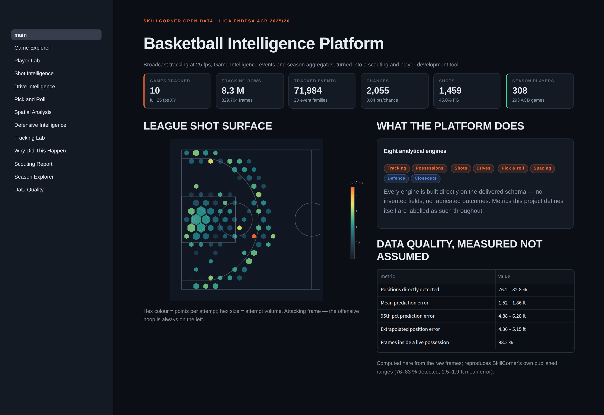
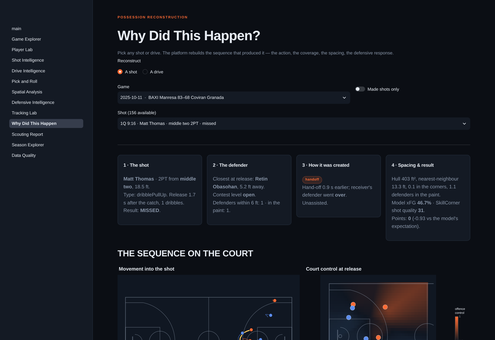
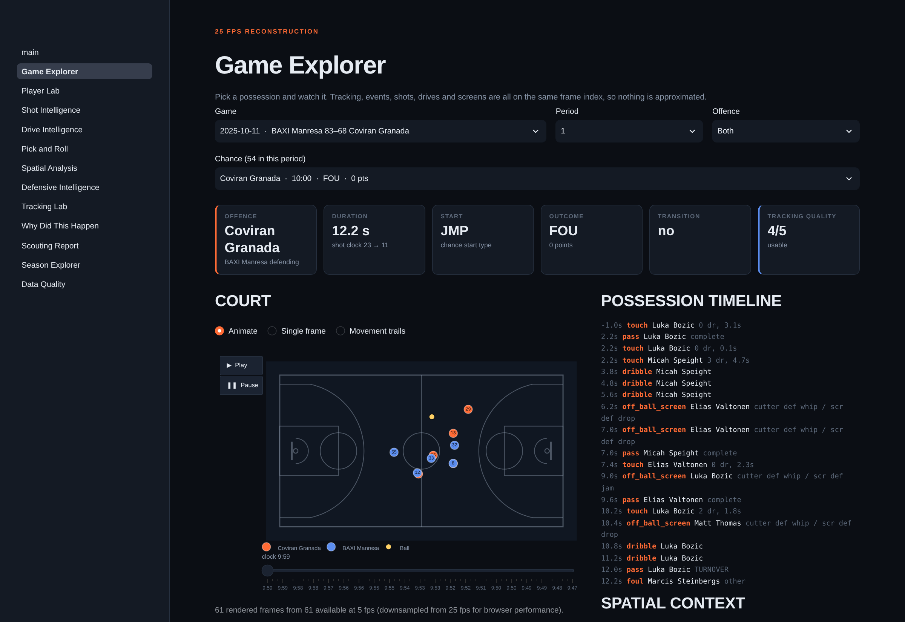
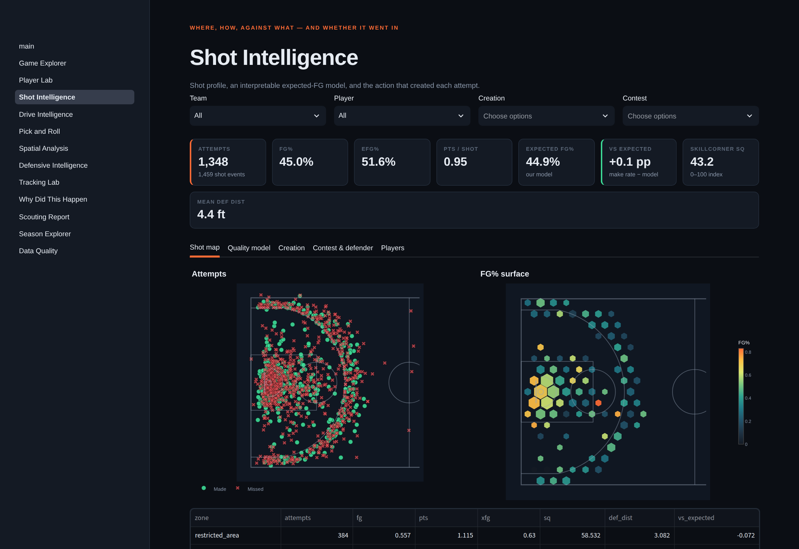
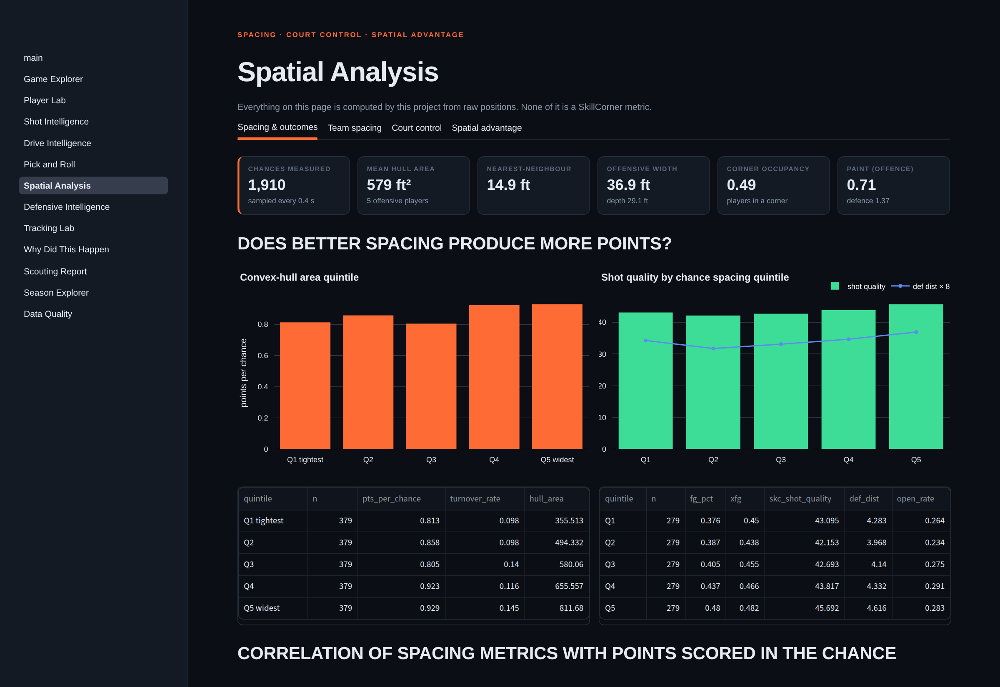

# Basketball Intelligence Platform

**A tracking-data analytics and scouting tool built on
[SkillCorner's basketball open data](https://github.com/SkillCorner/opendata-basketball)
— Liga Endesa ACB 2025/26.**

Ten games of 25 fps broadcast tracking (8.3 M player-frames), 72 k Game
Intelligence events across 20 tables, and season-level offensive aggregates over
293 games, turned into a possession-reconstruction, scouting and
player-development application.



---

## What it does

Twelve pages, eight analytical engines, one visual language: the court.

| Page | What you can do |
|---|---|
| **Home** | Dataset coverage, measured data quality, headline findings |
| **Game Explorer** | Pick any chance and watch it — animated 25 fps tracking, movement trails, a synchronised event timeline, live spacing |
| **Player Lab** | Multi-dimensional player cards, percentile comparison, season style similarity, role clustering |
| **Shot Intelligence** | Shot maps, an interpretable expected-FG model with calibration, and how each shot was created |
| **Drive Intelligence** | Drive maps and outcomes, plus the defensive collapse curve sampled every 0.2 s |
| **Pick & Roll** | Coverage-by-coverage outcomes for handlers and screeners, coverage-pair matrix, tracking-derived roll/pop |
| **Spatial Analysis** | Spacing metrics, a time-to-arrive court-control model, spatial advantage through a possession |
| **Defensive Intelligence** | Closeout geometry and outcomes, coverage mix, matchup workload, contest profiles |
| **Tracking Lab** | Raw signal quality, raw-vs-smoothed comparison, physical output, a full-rate frame inspector |
| **Why Did This Happen?** | Reconstructs any shot or drive: the action, the defender, the spacing, the defensive response, the outcome |
| **Scouting Report** | How a team attacks and defends, with automated evidence-backed notes |
| **Season Explorer** | The 293-game aggregates as a searchable database, with duplicate player ids merged |

<table>
<tr>
<td width="50%"><br/><sub><b>Why Did This Happen?</b> — a shot reconstructed from its creating action, defender, spacing and court control.</sub></td>
<td width="50%"><br/><sub><b>Game Explorer</b> — animated tracking synchronised with the possession timeline.</sub></td>
</tr>
<tr>
<td width="50%"><br/><sub><b>Shot Intelligence</b> — shot surface, quality model, creation lineage.</sub></td>
<td width="50%"><br/><sub><b>Spatial Analysis</b> — spacing, court control, spatial advantage.</sub></td>
</tr>
</table>

---

## Findings

Ten studies with evidence, basketball interpretation and limitations are in
[`docs/CASE_STUDIES.md`](docs/CASE_STUDIES.md). Six of the strongest:

**1. Defender distance tells you nothing — until you know where the shot came
from.** Marginally, makes and misses have indistinguishable defender distances
(4.43 vs 4.61 ft, p = 0.31, wrong sign). Control for shot location and each
extra foot is worth **+0.102 log-odds** (OR 1.107, p < 10⁻⁵). A clean Simpson's
paradox: the highest-percentage shots are the most contested. Within strata the
effect is huge at the rim (p = 1.7 × 10⁻⁷) and **absent on above-the-break
threes** (p = 0.83).

**2. Transition creates much better shots and exactly the same points.** Shot
quality 50.6 vs 41.9, contested 56 % vs 75 %, both p < 10⁻⁵ — and 0.829 vs 0.838
points per chance (p = 0.89). The extra turnovers eat the edge. Running is a
tempo decision, not an efficiency one.

**3. Off-ball movement buys a foot of separation and converts it into nothing.**
The busiest movement quartile gains **+1.005 ft** of separation (CI [0.59, 1.42])
and 5 points of expected FG% — and shoots exactly the same 42.6 % (gap CI
[−7.5, +7.2] pp).

**4. Help arrives fast, and hardest on the drives that score.** Across 660
drives and 8,351 samples, the help defender closes **7.35 ft** and the paint
gains **1.78 defenders**. Rim attacks pull the most help *and* return the most
points — help is the consequence of an advantage, not its refutation. Kick-outs
pull nearly as much help (7.0 ft) and return 0.42 points against 0.76.

**5. Tight closeouts cut points by a fifth and double the fouls.** Arriving
within 4 ft: 0.558 vs 0.769 points allowed (CI [0.013, 0.401]), fouls 11.6 % vs
4.7 % (p = 0.0035), identical stop rate. The bigger lever is the response — a
closeout that forces a pass is worth 0.55 points more than one conceding a shot,
and those are the *slowest* closeouts, not the fastest.

**6. ACB offensive roles are a continuum, not a set of archetypes.** Silhouette
peaks at **0.266** (k = 3) and never exceeds 0.27 for any k from 3 to 9. The
three poles that emerge — interior finisher, movement shooter, on-ball creator —
are real; everything finer is interpolation.

Also reported, with the same prominence: **spacing adds ~0.002 AUC** to the shot
model once location and defender distance are known, and **SkillCorner's own
`shotQuality` beats our model** (AUC 0.711 vs 0.689).

---

## Architecture

```
SkillCorner open data (JSON / JSONL.gz / CSV)
        │
        ├── validation ─────────────► src/data/quality.py       192 automated checks
        │
        ▼
   normalisation      src/data/ingest.py
        │             snake_case · [x,y] exploded · list[str] joined
        │             player ids canonicalised through the alias map
        ▼
 canonical model      data/processed/{dim,events,aggregates,tracking}/*.parquet
        │
        ▼
feature engineering   src/{tracking,preprocessing,possessions,spatial,
        │                  shots,drives,picks,defense,features,models}
        ▼
 analytics tables     data/derived/*.parquet   (33 tables, 12 MB)
        │
        ▼
   DuckDB views       data/processed/basketball.duckdb  (79 objects, 780 KB)
        │
        ▼
 Streamlit app        app/  ·  12 pages  ·  Plotly
```

**Storage.** Tracking is partitioned Parquet, one file per game, zstd level 9,
with redundant derivative columns dropped and coordinates rounded to 0.01 ft —
617 MB → **205 MB** with no loss of anything used downstream. A separate 5 fps
`tracking_viz` layer (13 MB) backs the animation so the browser never receives
25 fps frames.

**Query.** DuckDB reads the Parquet in place; nothing is copied that it can scan.
Reading four columns of one game's tracking takes 20 ms; a filtered aggregate
over all 8.3 M rows takes 0.28 s.

**Never done:** loading the full tracking table into memory, or into the browser.

### Repository layout

```
basketball-intelligence/
├── app/
│   ├── main.py                     home / executive overview
│   ├── pages/                      11 analysis pages
│   └── components/                 theme, cached data access, court plotting
├── src/
│   ├── config.py                   paths, FIBA geometry, pipeline constants
│   ├── data/                       loaders, ingest, aliases, warehouse, quality
│   ├── preprocessing/court.py      coordinate frames, transforms, zoning
│   ├── tracking/                   segmentation, smoothing, kinematics, context
│   ├── possessions/engine.py       chance summaries, timelines, action chains
│   ├── spatial/                    spacing, defensive geometry, court control
│   ├── shots/                      feature assembly, xFG model
│   ├── drives/  picks/  defense/   action engines
│   ├── features/                   player and team profiles, transition
│   └── models/similarity.py        style space, similarity, clustering
├── scripts/                        00–12, the ordered pipeline
├── notebooks/                      8 analysis notebooks
├── tests/                          125 pytest tests
├── docs/                           DATA_DICTIONARY · METHODOLOGY · ANALYTICS
│                                   LIMITATIONS · CASE_STUDIES
└── reports/                        findings.json, screenshots
```

---

## How to run

```bash
git clone <this repo> && cd basketball-intelligence
python -m venv .venv && source .venv/bin/activate
pip install -r requirements.txt

# 1. Fetch the SkillCorner open data (tracking files are Git LFS objects)
python scripts/fetch_data.py            # ~380 MB, downloads in parallel

# 2. Build everything: ingest → tracking → features → models → warehouse
make build                              # ~5 minutes on 2 vCPU

# 3. Run
streamlit run app/main.py               # http://localhost:8501
```

Individual stages, in order:

```bash
python scripts/00_recon.py              # profile the raw schema
python scripts/01_ingest.py             # → canonical Parquet + alias merge
python scripts/02_tracking.py           # smoothing, kinematics, possession context
python scripts/03_spatial_features.py   # spacing at every event moment
python scripts/04_shots.py              # shot features + xFG model
python scripts/05_drives_picks.py       # drive and pick-and-roll engines
python scripts/06_defense.py            # closeouts, matchups, contests
python scripts/07_players.py            # profiles, similarity, clustering
python scripts/08_team_transition.py    # team profiles, transition, chains
python scripts/09_warehouse.py          # DuckDB views
python scripts/10_quality.py            # data-quality suite (exits 1 on FAIL)
python scripts/11_findings.py           # every number in the docs
python scripts/12_gen_data_dictionary.py
```

Tests:

```bash
pytest -q                               # 125 tests, ~25 s
pytest tests/test_statistics.py -v      # the published findings, as assertions
```

---

## Validation

Nothing in this project is trusted because the documentation says so. Every
claim about the data is re-derived and checked.

| Check | Result |
|---|---|
| Team scores from `shots` + `free_throws` vs official | **10/10 games exact** |
| Recomputed shot distance vs delivered `shots.distance` | median error **0.010 ft** |
| Our nearest-defender distance vs `closestDefDist` | median **0.01 ft**, 98.2 % within 1 ft |
| Shooter position from tracking vs `shots.location` | median **0.005 ft** |
| Coordinate transform (attacking ↔ broadcast) | median |Δx|, |Δy| = **0.0000 ft**, n = 1,458 |
| Our three-point line vs delivered `three` flag | **98.4 %** agreement |
| Detection rate vs SkillCorner's published 76–83 % | **76.2–82.8 %** |
| Mean `predError` vs published 1.5–1.9 ft | **1.52–1.86 ft** |
| Alias merge preserves aggregate totals | exact, all three files |
| Direct-pick rate vs documented ~52 % | **54.1 %** |
| Automated data-quality suite | **192 checks, 0 FAIL, 3 WARN** |
| Test suite | **125 passed** |

The 3 warnings are the 7 orphaned `touchId` references (0.029 %) described in
[`docs/LIMITATIONS.md`](docs/LIMITATIONS.md).

Two properties of the data found here and **not documented upstream**:

* The video frame index jumps at every period boundary (2 to 2,075 frames);
  it is perfectly continuous within a period.
* 7 of 24,487 `touchId` references point at a touch that does not exist.

---

## Performance

| | |
|---|---|
| Raw input | 380 MB (10 tracking files) + 35 MB events and aggregates |
| Tracking rows | 8,297,040 player-frames · 1,472,932 video frames |
| Event rows | 71,984 across 20 tables |
| Full build | **~5 minutes** (2 vCPU, 8 GB) |
| Ingest (all 10 games) | 32 s |
| Tracking enrichment | 41 s |
| Spatial features | 135 s |
| Processed store | 205 MB tracking + 13 MB viz + 12 MB derived + 780 KB DuckDB |
| Read 4 columns of one game | 20 ms |
| Aggregate over all 8.3 M rows | 0.28 s |
| App page load | < 2 s cold, < 200 ms warm |

Optimisations that mattered: dropping recoverable derivative columns and
rounding coordinates (3× smaller Parquet), a separate 5 fps animation layer,
PyArrow row-group filters for frame-window reads, `@st.cache_data` on every
derived table, and vectorised segment arithmetic instead of pandas `groupby`
loops in the tracking engine.

---

## Limitations

Read [`docs/LIMITATIONS.md`](docs/LIMITATIONS.md) before quoting anything. The
short version:

* **Ten games.** 10–30 shots, 8–27 drives, 8–25 closeouts per player. A 15-shot
  FG% has a ±13 pp standard error. Nothing here ranks players or teams.
* **Broadcast tracking**: 17–24 % of positions are extrapolated at 4.4–5.2 ft
  error. Fine for spacing and defender distance; useless for sub-foot questions.
  Player `z` is always 0.
* **Season aggregates are offence only.** There is no defensive rating in this
  platform, on purpose.
* **Event and coverage labels are model output**, with an unpublished error rate.
* **Metrics this project invents** — xFG, movement bands, roll/pop, court
  control, spatial advantage — are labelled as such everywhere in the UI and are
  never presented as SkillCorner metrics. The court-control and
  spatial-advantage models have no external validation and say so on screen.

---

## Credit

Data: **[SkillCorner](https://skillcorner.com)** — basketball open data, Liga
Endesa ACB 2025/26, released for research use. All analysis, models and code
here are this project's own; where a number comes from SkillCorner it is
labelled as delivered.
